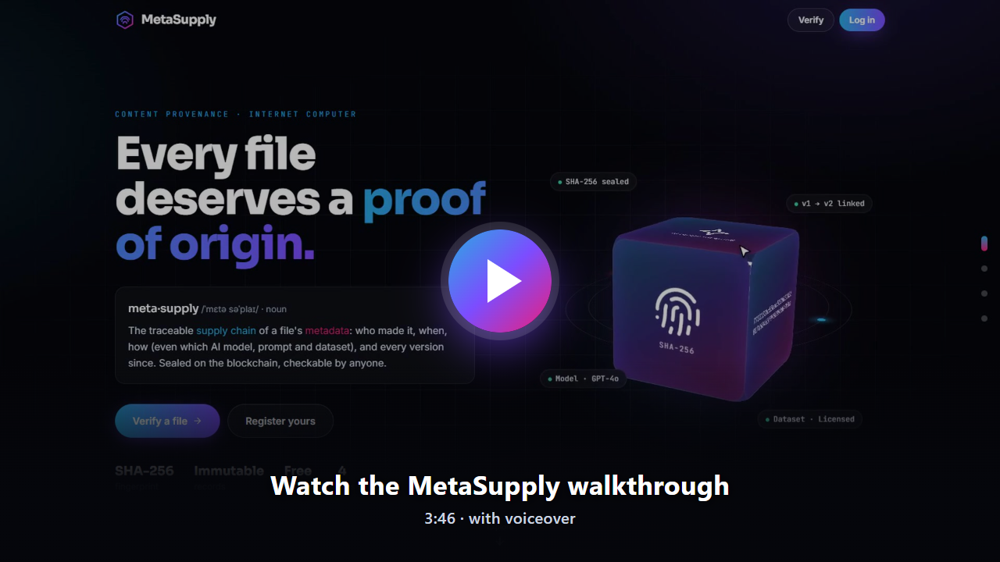
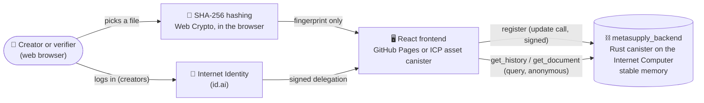

<div align="center">


# MetaSupply

**Proof of origin for papers, files and AI-generated content, sealed on the Internet Computer.**

[Live website](https://shivaraaman.github.io/Metasupply/) · [Walkthrough video](#-walkthrough-video) · [Architecture](#-architecture) · [Local setup](#-local-setup)

</div>

---

## ✨ What is MetaSupply?

*meta·supply* /ˈmɛtə səˈplaɪ/: the traceable **supply chain** of a file's **metadata**.

Today anyone can claim they made a file first, quietly edit a document, or pass off AI-generated content without saying how it was made. MetaSupply answers four questions about any file, in a way nobody can fake afterwards:

| Question | How MetaSupply answers it |
|---|---|
| **Is this the original file?** | The file's SHA-256 fingerprint is recorded. Change one character and the fingerprint no longer matches. |
| **When did it exist, and who made it?** | The Internet Computer's own clock timestamps the record, together with the author and the creator's Internet Identity account. |
| **How was it made?** | For AI-generated content: the AI model, generation tool, prompt, training dataset and that dataset's licence (open, licensed, private, scraped or unknown). |
| **What changed since?** | Each new version links to the previous one, so the full history can be traced from any version. |

### Key features

- 🔏 **Tamper-proof records.** The canister has no edit or delete functions, and a given file can only be registered once, so the first registration proves priority.
- 🧬 **Version chains.** Only the owner can add versions, and only to the latest one, so the history is a single line.
- 🔍 **Public verification.** Anyone can drop a file, paste a fingerprint or scan a QR code to see its record and full history, without logging in.
- 🤖 **AI provenance.** Optional fields record how AI-generated content was produced.
- 🔒 **Private by design.** Files are hashed in the browser and never uploaded; only the fingerprint goes on-chain.
- 🪪 **Internet Identity login** for creators, using passkeys, no passwords.

---

## 🎬 Walkthrough video

[](https://shivaraaman.github.io/Metasupply/media/metasupply-walkthrough.mp4)

▶️ **[Watch the walkthrough](https://shivaraaman.github.io/Metasupply/media/metasupply-walkthrough.mp4)** (3 min 46 s, 1080p, with voiceover). The file is also in the repo at [`src/metasupply_frontend/public/media/metasupply-walkthrough.mp4`](src/metasupply_frontend/public/media/metasupply-walkthrough.mp4).

The video covers the home page, verifying a registered file and its version history, catching a file edited by one character, an AI-generated record, registering a new AI image, adding a second version, and the fingerprint playground. It was recorded on a local test setup with sample records; the voiceover uses a Microsoft neural voice.

<details>
<summary><b>Video transcript</b></summary>

**0:00** Hi, and welcome to MetaSupply. Over the next few minutes, I'll show you how it proves where a file came from… and how anyone can check it.

**0:09** This is the home page. The name says it all: MetaSupply is a supply chain for your content's metadata. Who made a file, when it was made, how it was made, even which AI model, prompt and dataset were used, and every version since. All of it, sealed on the Internet Computer blockchain.

**0:29** That glowing block represents a sealed record. Each face is something we capture: a fingerprint, a timestamp, a QR code, the AI recipe, and tamper-proof protection.

**0:42** Scroll down, and you choose your path. Anyone can verify a file, no account needed. Creators log in once to register their work.

**0:51** Let's verify a file. I'll drop in the final draft of a research paper. Notice that the fingerprint is computed right here in the browser. The file itself never leaves this computer.

**1:03** And there it is: registered. We can see the title, the author, the exact date and time it was sealed, and its SHA-256 fingerprint. There's a QR code too, so anyone can scan it and land right on this proof.

**1:20** Below that is the version history. This paper has two versions. The final draft links back to the first one, so the whole story of the document is kept, in order.

**1:31** Now, what if someone quietly edits the file? Here's a copy with just one character changed.

**1:37** Not registered. Change even a single character, and the fingerprint is completely different. That's how MetaSupply catches tampering, instantly.

**1:47** MetaSupply was built with AI-generated content in mind. This image was made with Stable Diffusion. Along with the usual details, the record shows how it was generated: the model, the tool, the prompt, the training dataset, and whether that data was licensed, or scraped from the web.

**2:07** Registering is just as simple. Let me log in. On this local test setup, a temporary test identity stands in for Internet Identity.

**2:16** This is my creator panel. It's empty for now, so let's register something.

**2:22** First, I pick the file: a poster I made with AI. I give it a title and an author name, and set the content type to image. Then I switch on, generated with AI, and add the model, the tool, the prompt, and the dataset licence.

**2:39** One click, and it's sealed.

**2:41** Sealed on-chain. From this moment, the record can't be edited or deleted, not even by me. And I can share the link or the QR code with anyone.

**2:52** Later, I made a revised poster. From my documents, I choose, register new version, pick the new file, and describe what changed. The AI details carry over automatically.

**3:05** And now my creator panel shows both versions, linked together in one chain.

**3:11** Back on the home page, the how it works section sums it all up in four steps: register, update, verify, and stay private.

**3:21** You can even try the core idea yourself. Type anything, and watch its fingerprint. Change just one letter, and almost every character changes.

**3:31** Finally, you'll find the project on GitHub, and soon on Instagram. That's MetaSupply: proof of origin for papers, files, and AI-generated content. Thanks for watching.

</details>

---

## 🧭 Using the website

| Page | Who | What you can do |
|---|---|---|
| **Home** | Everyone | Learn what MetaSupply is, start verifying or registering, see how it works, try the live fingerprint playground. |
| **Verify** (`#/verify`) | Everyone, no login | Drop a file or paste a SHA-256 fingerprint. See **Registered** with all details, AI info, a QR code and the version timeline, or **Not registered**. |
| **Register** (`#/register`) | Logged-in creators | Pick a file (hashed locally), add title, author, description and content type, optionally the AI details, and seal it. Can also be a new version of an earlier document. |
| **My documents** (`#/my-documents`) | Logged-in creators | Your records grouped into version chains, each with **Register new version**. |

---

## 🏗 Architecture



**How a registration flows:**

1. The browser reads the file and computes its SHA-256 fingerprint with the Web Crypto API. The file never leaves the device.
2. The creator logs in with Internet Identity, which gives the browser a signed identity (a *principal*).
3. The frontend calls the canister's `register` method with the fingerprint and details, signed by that identity.
4. The canister checks the input, rejects duplicates and invalid version links, stamps the record with the Internet Computer's time, and stores it in **stable memory**, which survives canister upgrades.
5. Anyone can later call `get_history` with a fingerprint, anonymously, to see that record and every linked version.

### Components

| Part | Location | Technology |
|---|---|---|
| Backend canister | [`src/metasupply_backend`](src/metasupply_backend) | Rust, `ic-cdk` 0.12, `ic-stable-structures` (StableBTreeMap), Candid |
| Candid bindings | [`src/declarations/metasupply_backend`](src/declarations/metasupply_backend) | Generated by `dfx generate`, committed so the frontend builds without dfx |
| Frontend | [`src/metasupply_frontend`](src/metasupply_frontend) | React 18, TypeScript, Vite, Tailwind CSS, React Router (hash routing) |
| ICP client | `@icp-sdk/core`, `@icp-sdk/auth` | Agent, Candid encoding, Internet Identity sign-in |
| Hosting | GitHub Pages (`gh-pages` branch) | Built and published by GitHub Actions |
| CI | [`.github/workflows/deploy.yml`](.github/workflows/deploy.yml) | Backend tests and wasm build, frontend build and deploy |

### Data model

```candid
type Document = record {
  hash : text;                 // SHA-256 of the file, 64 lowercase hex characters
  title : text;
  author : text;               // as entered by the creator
  description : text;
  file_name : text;
  file_size : nat64;
  content_type : ContentType;  // Document | Image | Text | Code | Audio | Video | Dataset | Other
  ai : opt AiDetails;          // present for AI-generated content
  owner : principal;           // Internet Identity account that registered it
  registered_at : nat64;       // nanoseconds since 1970, from the Internet Computer
  previous_hash : opt text;    // the version this one replaces
  version : nat32;             // 1, 2, 3, …
};

type AiDetails = record {
  model : text; tool : text; prompt : text; dataset : text;
  dataset_license : DatasetLicense;   // Open | Licensed | Private | Scraped | Unknown
};
```

### Canister API

| Method | Type | Description |
|---|---|---|
| `register(RegisterArgs) -> Result<Document, RegisterError>` | update | Registers a fingerprint, optionally as the next version of one of the caller's documents. Errors: `AlreadyRegistered(Document)` or `Rejected(text)`. |
| `get_document(text) -> opt Document` | query | One record by fingerprint. |
| `get_history(text) -> vec Document` | query | Every version in the chain containing that fingerprint, oldest first. |
| `get_my_documents() -> vec Document` | query | The caller's records. |
| `total_documents() -> nat64` | query | Number of registered records. |

The full interface is in [`metasupply_backend.did`](src/metasupply_backend/metasupply_backend.did). A unit test fails if it falls out of date with the Rust code.

### Rules enforced on-chain

- Anonymous callers can't register.
- Fingerprints must be 64 hex characters, and each fingerprint can only be registered once.
- Required fields are checked, with length limits (title 200, author 100, description 2,000, prompt 4,000 characters).
- A new version must point to an existing record **owned by the caller** that doesn't already have a newer version.
- Each account can register up to 1,000 records, to limit abuse.

### Project structure

```
Metasupply/
├── .github/workflows/deploy.yml     # CI: test + build backend, build + publish frontend
├── dfx.json                         # canisters: backend, frontend (assets), Internet Identity
├── Cargo.toml                       # Rust workspace
├── scripts/setup-mainnet.sh         # guided identity + cycles coupon setup
├── docs/media/                      # README images
└── src/
    ├── metasupply_backend/          # Rust canister
    │   ├── src/lib.rs               # data model, rules, API, unit tests
    │   └── metasupply_backend.did   # Candid interface
    ├── declarations/                # generated JS/TS bindings for the canister
    └── metasupply_frontend/         # React app
        ├── public/                  # favicon, ICP badge, walkthrough video
        └── src/
            ├── pages/               # Home, Verify, Register, My documents, Login
            ├── components/          # Navbar, FileDrop, timeline, QR, icons…
            │   └── home/            # hero 3D block, sections, fingerprint playground
            ├── contexts/AuthContext.tsx
            ├── services/            # canister agent, document helpers
            └── config.ts            # GitHub / Instagram links
```

---

## 💻 Local setup

### Prerequisites

| Tool | Version | Notes |
|---|---|---|
| [Node.js](https://nodejs.org) | 18+ | npm 7+ |
| [Rust](https://rustup.rs) | stable | plus `rustup target add wasm32-unknown-unknown` |
| [dfx](https://internetcomputer.org/docs/building-apps/getting-started/install) | 0.2x+ | The ICP SDK. **On Windows, use WSL (Ubuntu)**; dfx doesn't run natively on Windows. |

Install dfx (in WSL or on macOS/Linux):

```bash
sh -ci "$(curl -fsSL https://internetcomputer.org/install.sh)"
```

### 1. Clone and install

```bash
git clone https://github.com/shivaraaman/Metasupply.git
cd Metasupply
npm install
```

### 2. Test the backend

```bash
cargo test -p metasupply_backend
```

This runs 11 tests covering registration, duplicates, version rules, AI details and the Candid interface check.

### 3. Run everything locally

```bash
dfx start --clean --background   # local Internet Computer replica
dfx deploy                       # backend, local Internet Identity and frontend
```

Open the `metasupply_frontend` URL printed by `dfx deploy`. For hot reload while editing the frontend:

```bash
npm start                        # http://localhost:8080
```

> **Local test login:** if Internet Identity isn't deployed locally (for example, you only deployed the backend), the Log in button creates a temporary test identity in the browser instead, so you can still try registering. This only exists in local builds, never on mainnet.

### 4. Useful commands

| Command | What it does |
|---|---|
| `npm run build` | Type-checks and builds the frontend into `src/metasupply_frontend/dist` |
| `npm run generate` | Regenerates the Candid bindings after changing the backend's public API |
| `cargo test -p metasupply_backend` | Prints the new Candid interface if `metasupply_backend.did` is out of date |
| `dfx canister call metasupply_backend total_documents` | Calls the local canister from the command line |

### Environment variables (frontend build)

| Variable | Purpose | Default |
|---|---|---|
| `CANISTER_ID_METASUPPLY_BACKEND` | Backend canister ID | read from `.env`, which `dfx deploy` writes |
| `CANISTER_ID_INTERNET_IDENTITY` | Local Internet Identity canister | read from `.env`; unused on mainnet |
| `DFX_NETWORK` | `ic` for mainnet, anything else for local | `local` |
| `BASE_PATH` | URL path the site is served from | `/` (`/Metasupply/` on GitHub Pages) |

---

## 🚀 Deployment

### Backend on the Internet Computer mainnet

Deploying needs **cycles** (the Internet Computer's fuel). A small canister like this costs a few US dollars to create and fractions of a cent per year to run. Get cycles from a hackathon coupon or by converting ICP.

```bash
bash scripts/setup-mainnet.sh                 # creates the "metasupply" identity, redeems a coupon, shows the balance
dfx deploy --network ic metasupply_backend
dfx canister --network ic id metasupply_backend
```

Commit the `canister_ids.json` that dfx creates, so later deploys upgrade the same canister. To host the website on the Internet Computer too, run `dfx deploy --network ic`.

> **Optional, permanent immutability:** once you're confident in the code, you can remove your identity as the canister's controller ("blackholing") so nobody can ever change it. This can't be undone: you won't be able to fix bugs afterwards. See the ICP documentation on canister controllers.

### Website on GitHub Pages

Every push to the `deployment` branch runs the workflow, which tests the backend and builds and publishes the frontend to the `gh-pages` branch.

1. In **Settings → Secrets and variables → Actions → Variables**, add `CANISTER_ID_METASUPPLY_BACKEND` with the mainnet canister ID.
2. In **Settings → Pages**, set **Source** to *Deploy from a branch*, branch `gh-pages`, folder `/ (root)`.
3. Push to `deployment`, or re-run the workflow. The site appears at **https://shivaraaman.github.io/Metasupply/**.

---

## 🗺 Roadmap

- [x] Backend registry with versions and AI provenance
- [x] Public verification by file, fingerprint or QR code
- [x] Redesigned website and walkthrough video
- [ ] Deploy the backend to mainnet and connect the live site
- [ ] Instagram link (set `INSTAGRAM_URL` in [`config.ts`](src/metasupply_frontend/src/config.ts))
- [ ] Certified responses for verification queries
- [ ] Optional: blackhole the canister for permanent immutability

---

<div align="center">

Built on the Internet Computer · [GitHub](https://github.com/shivaraaman/Metasupply)

<a href="https://internetcomputer.org"></a>

</div>
